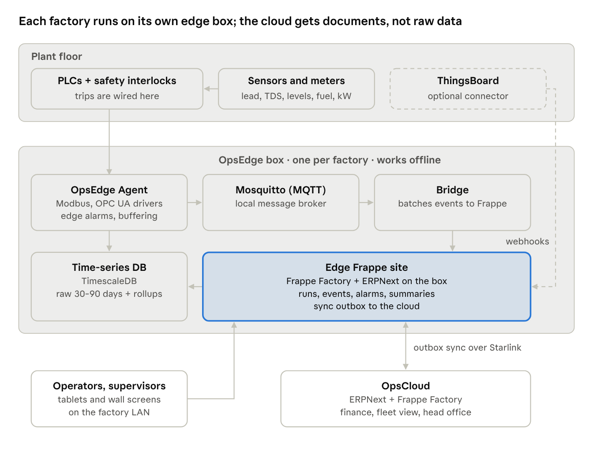
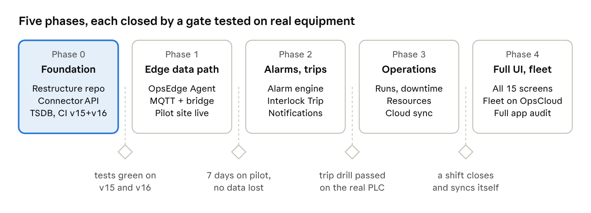

# Frappe Factory — Architecture

Nov 22, 2026 · I-Varse Technologies NG

> Source of truth: this file. A live editable copy was drafted in Claude Docs during planning.

## Summary and principles

Frappe Factory becomes a full factory operations app (MES layer) on top of ERPNext. It runs a live plant mimic, production runs, downtime, quality, resources (water, fuel, power) and alarms. It ships its own IoT layer (the OpsEdge Agent) and keeps ThingsBoard as an optional connector. It runs on Frappe v15 and v16, with a frappe-ui frontend for operators and managers and Desk for admins.

The starting point is repo `puzzo-dev/frappe_factory` v4.1.0: 8 DocTypes, ThingsBoard webhooks, an edge sync API, 5 roles and a basic jQuery floor page. We keep what works and restructure the rest.

Non-negotiables. Every phase is checked against these:

1. **Safety interlocks never depend on our software.** A trip that stops production (for example lead over limit) is wired in the PLC or relay logic. Frappe Factory observes, records, alarms and runs the recovery workflow. It never sits in the trip path.
2. **ERPNext is the system of record** for items, stock, BOMs, Work Orders, Quality Inspections, employees and workstations. Frappe Factory adds to them and never duplicates them.
3. **Raw telemetry never goes into MariaDB.** Frappe stores events, summaries and business documents only. Readings live in a time-series database.
4. **The edge works offline.** A factory keeps running and recording when the internet link (Starlink) is down. Data goes to the cloud later, in order, with nothing lost.
5. **Off-the-shelf parts for commodity work.** Broker, drivers, time-series storage and UI kit are existing open-source packages. We write the glue, the domain logic and the screens.
6. **One connector contract.** Direct (OpsEdge Agent) and ThingsBoard both deliver the same normalized messages. Nothing above the connector knows which one is in use.
7. **White-label ready.** The product names on screen are Frappe Factory, OpsEdge and OpsCloud. No third-party branding is visible to end users.

## System context

Each factory runs a complete stack on its OpsEdge box and keeps working when the link is down. OpsCloud receives documents, events and summaries, not raw readings.



Readings flow up from the PLCs through the agent. Raw values go to the time-series database. Events and alarms go through MQTT and the bridge into the edge Frappe site, which reads trends back from the time-series database. The dashed path is the optional ThingsBoard connector. Safety trips happen in the PLC and are only reported upward.

## IoT connector interface

Every site picks one connector in **Factory Configuration → IoT Connector**: `Direct` (default) or `ThingsBoard`. Both adapters turn their input into the same four normalized message types. Alarm, production and UI code read only these types.

| Message | Carries | Typical rate |
| --- | --- | --- |
| `TelemetryBatch` | device, tag, timestamp, value, quality | seconds (goes to the time-series database, not to Frappe) |
| `StateChange` | device, from-state, to-state, reason code, timestamp | on change |
| `AlarmEvent` | device, alarm code, severity, raised/cleared, value, timestamp | on change |
| `DeviceStatus` | device, online/offline, firmware, last seen | on change and heartbeat |

**Python contract** (`frappe_factory/iot/connectors/base.py`):

- `class IoTConnector(ABC)` with `ingest(raw) -> list[Message]`, `provision_device(device) -> Credentials`, `revoke_device(device)`, `send_command(device, command)`, `health() -> dict`.
- `get_connector()` reads Factory Configuration and returns the adapter. Adapters register through a hook (`frappe_factory_connectors`), so a third connector (for example a customer's own SCADA) needs no core change.
- Handlers downstream: `on_state_change`, `on_alarm_event`, `on_device_status`. They are the same for every connector.

**Direct adapter (OpsEdge Agent).** The agent publishes to the local Mosquitto broker on topics `factory/<site>/<device>/{telemetry,state,alarm,status}`. A small bridge service subscribes and posts state, alarm and status messages to Frappe in batches through one authenticated, whitelisted endpoint (API key + secret of the factory system user). Telemetry goes from the agent straight to the time-series database.

**ThingsBoard adapter.** The current `iot/webhooks.py` and `iot/thingsboard.py` move to `iot/connectors/thingsboard/`. ThingsBoard rule chains post to the same handlers. Telemetry from ThingsBoard is not stored in Frappe: dashboards read it from ThingsBoard's own API through the same virtual DocType interface (see data tiers). The current token checks, IP allowlist and rate limits stay.

**Device identity.** `IoT Device Registry` keeps one generic `external_id` + `connector` pair instead of `thingsboard_device_id` copied into three DocTypes. Credentials are Password fields, never in `site_config.json`.

Note on licensing: ThingsBoard 4.4 (Sept 2026) is under BSL 1.1. Commercial use above 100 devices, or without ThingsBoard branding, needs a paid licence per customer organization. Sites that choose this connector carry that cost. The Direct connector has no such limit.

## Data tiers and volume handling

Frappe gets rows at human speed. Machines write at machine speed into a time-series database. Example plant: 60 tags sampled every second.

| Tier | Example | Rows per day | Store | Retention |
| --- | --- | --- | --- | --- |
| Raw readings | tank level every 1 s | ~5.2M | Time-series DB on the edge | 30–90 days (setting) |
| Rollups | min/max/avg per tag per minute | ~86k | Time-series DB (continuous aggregate) | 2 years, then hourly forever |
| Summaries | per-shift output, uptime, fuel, water, energy | tens | Frappe DocType | Forever |
| Events | state changes, alarms, trips | tens to hundreds | Frappe DocType (log type) | 90 days in Frappe, then summary only |
| Business documents | Work Order, Downtime Entry, Quality Inspection, Batch | a handful | Frappe / ERPNext | Forever |

**Time-series database.** PostgreSQL + TimescaleDB on the OpsEdge box (hypertables, continuous aggregates, retention policies, compression). Accessed only through `frappe_factory/timeseries/` (one repository class), never with raw queries from controllers.

**Raw data in Desk without storing it.** `Machine Telemetry` becomes a Virtual DocType. Its controller implements `get_list`, `get_count` and `load_from_db` against the time-series database (or ThingsBoard's API under that connector). Desk lists, filters and reports work. The frappe-ui charts call a whitelisted `get_series(device, tag, from, to, bucket)` that picks raw or rollup data by time range.

**Log DocTypes in MariaDB** (`Factory Event`, `OpsEdge Audit Log`, `OpsEdge Sync Log`):

- Registered in `default_log_clearing_doctypes` in hooks.py. Each implements `clear_old_logs(days)`. Admins change retention in Frappe's Log Settings. This replaces the current custom cleanup jobs.
- `autoname: autoincrement`. Track Changes, Track Seen, Track Views and global search off.
- Composite indexes on query paths, for example `(device, event_time)`.
- Written with `frappe.db.bulk_insert`, not `doc.insert()` in a loop.
- Default list filter: last 24 hours, sorted by the indexed time field.

**Summaries.** A scheduler job closes each shift into `Shift Production Summary` and each day into `Daily Plant Summary` (OEE, uptime, output, water, fuel, energy, trips). Reports older than 90 days read summaries only.

**Not used:** MariaDB table partitioning. It conflicts with Frappe's `name` primary key and complicates migrations. Retention plus summaries does the same job.

## Domain model

DocTypes are grouped into five Frappe modules. ERPNext DocTypes (Item, BOM, Work Order, Job Card, Workstation, Quality Inspection, Employee, Shift Type, Stock Entry) are linked, never copied. Field-level detail is in [erd.md](erd.md).

**Plant** (the physical model)

| DocType | Kind | Purpose |
| --- | --- | --- |
| Plant Area | Tree | Site → area → line → cell hierarchy |
| Plant Asset | Regular | A machine, tank, pump, generator or meter; links Workstation and the ERPNext Asset where they exist |
| IoT Device Registry | Regular (kept) | Device, connector, `external_id`, protocol, linked Plant Asset, credentials |
| Tag | Regular | One measured point: device, key, unit, scale, limits (low/high, low-low/high-high), sampling rate, role (level, flow, quality, energy…) |
| Plant Floor Layout + Widget | Regular + child (kept, extended) | The mimic: background, widgets bound to assets and tags, pipes and flow paths; each widget draws an HMI Symbol |
| HMI Symbol (+ Port, Binding) | Regular + 2 child (new) | The shared symbol library: one SVG drawing per equipment type, its pipe connection points and what can move (state, level, value, alarm, flow). Drawn once, reused at every site; versioned; mastered on OpsCloud |

**Operations**

| DocType | Kind | Purpose |
| --- | --- | --- |
| Production Run | Submittable | One run of a Work Order on a line: start/stop, counts good/reject, linked batch |
| Factory Event | Log (replaces Production Floor Event) | Machine-made state changes and trips, high volume, not submittable |
| Downtime Entry | Submittable | A stop that a supervisor gives a reason to; links its Factory Events |
| Downtime Reason | Tree | Planned / unplanned → category → reason |
| Shift Production Summary | Regular | Closed per shift: output, OEE parts, downtime, resources used |
| Daily Plant Summary | Regular | Same per day per site |

**Alarms**

| DocType | Kind | Purpose |
| --- | --- | --- |
| Alarm Definition | Regular | Tag, condition, severity, delay, deadband, interlock flag, response procedure |
| Alarm | Regular | One occurrence and its life: raised, acknowledged, cleared, shelved; who and when |
| Interlock Trip | Submittable | A safety trip and its recovery: cause, readings, actions (for example re-purify the slug), sign-off |

**Resources**

| DocType | Kind | Purpose |
| --- | --- | --- |
| Resource Meter | Regular | A tank, fuel level, water meter or power meter, bound to a Tag |
| Resource Reading | Log | Hourly snapshots from rollups for stock-style views (fuel in tank, water in reservoir) |
| Refill Entry | Submittable | Fuel or chemical delivery; can create an ERPNext Stock Entry |

**Platform**

| DocType | Kind | Purpose |
| --- | --- | --- |
| Factory Configuration | Single (kept) | Site settings, connector choice, retention, sync |
| Machine Telemetry | Virtual | Raw and rollup readings from the time-series database |
| OpsEdge Sync Log, OpsEdge Audit Log | Log (kept) | Sync and security trail |

**Changes to the current repo**

- `Production Floor Event` (submittable) splits into `Factory Event` (log) and `Downtime Entry` (submittable).
- `Machine Telemetry Log` (one MariaDB row per reading) becomes the virtual `Machine Telemetry`. A migration patch moves existing rows into the time-series database and drops the table.
- `Shift Attendance Summary` stays but reads from HRMS when installed. It is optional, not core.
- `thingsboard_device_id` fields on Widget and Telemetry are removed. The device link is enough.

## Alarms and safety interlocks

Alarms are evaluated at the edge, close to the data, and every alarm has a defined life in Frappe. The design follows the usual alarm-management practice (ISA-18.2): few alarms, each one needs an action, nothing floods the operator.

**Where each kind of check runs**

| Check | Runs in | Depends on network? | Example |
| --- | --- | --- | --- |
| Safety interlock | PLC / hardwired relay | No | Lead over limit closes the fill valve and stops the filler |
| Process alarm | OpsEdge Agent (rule evaluator) | No (edge only) | Tank low-low, RO pressure high, generator fuel below 20% |
| Business alarm | Frappe scheduler | No (edge Frappe site) | Production lag vs Work Order, no output for 15 min in a running shift |
| Fleet alarm | OpsCloud | Yes | Site offline for more than 30 min |

**Interlocks.** The PLC owns the trip. The agent reads the trip bit and the interlock state as tags and reports an `AlarmEvent` with the interlock flag. Frappe then:

1. Opens an **Interlock Trip** with the readings around the trip (from the time-series database, for example 10 min before and after).
2. Stops the running Production Run and opens a Downtime Entry with reason "Safety trip".
3. Notifies Floor Supervisor and Factory Manager (Frappe in-app and email notifications, and WhatsApp through frappe_whatsapp_openwa).
4. Runs the recovery checklist from the Alarm Definition, for example: divert the slug to the re-purify tank, flush, re-test, record the lab value.
5. Restart needs a supervisor sign-off in the app **and** the physical reset at the panel. The app never sends a reset command to a safety circuit.

**Alarm lifecycle.** Raised → Acknowledged → Cleared → Closed. Side states: Shelved (time-limited, with a reason) and Suppressed (by design, for example when the line is in planned stop). Return-to-normal without acknowledgement is still logged.

**Flood control.** Each Alarm Definition has an on-delay, an off-delay and a deadband. Repeats within a window are counted on one Alarm, not raised again. A "chattering" report lists alarms that raise more than N times per shift.

**Commands.** Release 1 is monitor-only. The command path (start a pump, change a setpoint) ships disabled behind three switches. When enabled later, each command needs a role, a reason and an approval, and goes into the audit log. The PLC can always refuse a command.

## Edge to cloud sync

Each factory runs a full edge Frappe site on its OpsEdge box. That site is the place where the factory works. OpsCloud receives a copy for head office, fleet views and ERPNext finance.

**What goes where**

| Data | Direction | How |
| --- | --- | --- |
| Masters (Item, BOM, Workstation, Employee, Alarm Definition, Downtime Reason, HMI Symbol) | Cloud → edge | Pulled on a schedule, cloud wins |
| Work Orders | Cloud → edge | Pulled; status updates go back |
| Production Runs, Downtime Entries, Interlock Trips, Quality Inspections, Refill Entries | Edge → cloud | Pushed when submitted, edge is the owner |
| Factory Events, Alarms | Edge → cloud | Pushed in batches; cloud keeps a shorter retention |
| Shift and Daily Summaries | Edge → cloud | Pushed when closed |
| Rollups (hourly) | Edge → cloud time-series DB | Optional, for fleet trends |
| Raw telemetry | Stays on the edge | Never sent; pulled on demand for an investigation |

**Mechanism.** An outbox table on the edge records every document change to sync (doctype, name, modified, operation). The `opsedge-sync` service reads the outbox in order and posts batches to OpsCloud's sync API. It retries with back-off when the link is down and resumes from the last acknowledged position. The existing `get_pending_records`, `mark_synced` and `log_sync_result` endpoints are extended into this outbox model.

**Ownership rule.** Every DocType has one owner side, so there are no merge conflicts. Edge-owned documents are read-only in the cloud, and cloud-owned masters are read-only on the edge. A document that both sides can edit is not allowed.

**Naming.** Documents created on the edge carry the site code in their name series (for example `KOYO1-RUN-2026-00042`), so names never collide across sites in the cloud.

**Bandwidth.** Starlink is the link at the first site. Without raw telemetry, a day of sync is expected to be small (summaries, events and documents only). The exact budget is measured in phase 2.

## Frontend

A Vue 3 + frappe-ui single-page app at `/factory`, built into the app's assets like Frappe Helpdesk and CRM. Desk stays for admins: configuration, masters, reports and the layout editor's advanced settings. The SCADA/HMI approach is in [scada-hmi.md](scada-hmi.md).

**Three shells, one codebase**

| Shell | Who | Device | Shape |
| --- | --- | --- | --- |
| Control room | Factory Manager, Floor Supervisor | Desktop, wall screen | Mimic, alarms, KPIs, trends; dense, dark theme option |
| Floor (kiosk) | Machine Operator, Quality Inspector | Tablet at the line | Large touch targets, one task per screen, PIN switch-user, works offline for short drops |
| Manager | Factory Manager, owner | Phone, desktop | Summaries, approvals, trips, multi-site on OpsCloud |

**Stack**

- `frappe-ui` components and `createResource` / `createListResource` for data. Pinned to a version that runs on both Frappe v15 and v16.
- Realtime through Frappe's socket.io: the bridge calls `frappe.publish_realtime` on `factory:<site>:state`, `:alarm` and `:tag:<tag>` rooms. Live tag values are throttled to 1 update per second per tag.
- Mimic and floor designer: SVG, drawn from the Plant Floor Layout. Widgets bind to tags and assets. Pipes animate flow when the upstream pump or valve is on.
- Charts: Apache ECharts for all trends and dashboards, reading `get_series`.
- PWA install for the kiosk shell, with a small IndexedDB queue for actions taken during a short network drop on the factory LAN.

**Desk.** A `Frappe Factory` workspace with shortcuts and number cards for admins. The jQuery `plant_floor_designer` page is retired after the SPA designer ships.

## Roles and permissions

The five existing roles stay, plus one for maintenance and one for integrations. Access to a Plant Area limits what a user sees, through User Permissions on Plant Area and a `permission_query_conditions` hook on area-scoped DocTypes.

| Role | Can do | Cannot do |
| --- | --- | --- |
| Factory Manager | Everything in their sites; configure alarms, layouts, retention; approve trip restarts | System settings, connector secrets (System Manager only) |
| Floor Supervisor | Start/stop runs, give downtime reasons, acknowledge and shelve alarms, sign off trip recovery | Change Alarm Definitions or layouts |
| Machine Operator | See their line, record counts and rejects, acknowledge alarms on their line | Shelve alarms, submit Downtime Entries |
| Quality Inspector | Quality Inspections, lab values in trip recovery, hold a batch | Production or alarm settings |
| Storekeeper | Refill Entries, resource readings, stock links | Production and alarms |
| Maintenance Technician (new) | Asset history, work on downtime, acknowledge equipment alarms | Production counts |
| Factory Integration (new) | API-only user for the bridge and sync service; writes events, alarms, device status | Desk or SPA login |

**Rules for the code** (from frappe/skills `frappe-app-dev`):

- Every `@frappe.whitelist` has `methods=[...]` and type hints on every parameter.
- `frappe.qb.get_query(..., ignore_permissions=False)` in user-facing code.
- `has_permission` hooks return `True` or `False`, never `None`.
- Guest endpoints exist only for the ThingsBoard adapter, with token, IP allowlist and rate limit. The Direct connector uses an authenticated API user, so it needs no guest endpoint.
- The factory system user loses `System Manager`. It gets only `Factory Integration` and the permissions that role needs.

## Versions and engineering workflow

One branch, `develop`, runs on Frappe and ERPNext `version-15` and `version-16`. CI tests both on every pull request.

**Keeping both versions working**

- `required_apps = ["erpnext"]`; HRMS is optional and detected at runtime.
- No API that exists only in v16. Where the versions differ, one helper in `frappe_factory/compat.py` hides the difference. The code agent checks the Frappe source of both branches before using a framework API.
- frappe-ui is pinned to one version tested on both.
- Patches in `patches.txt` must run on both versions.
- Expected extra cost: about 10–15% per feature. We review this at the end of phase 3 and can drop v15 when OpsCloud sites are on v16.

**Workflow for the code agent** (skills from [`frappe/skills`](https://github.com/frappe/skills))

| Step | Skill | What it means here |
| --- | --- | --- |
| Set up and run | `frappe-app-dev` | Pilot, not bench. Two benches: `pilot new ff15 --frappe-branch version-15 --database mariadb` and the same for `version-16`. MariaDB, because production uses it |
| Write code | `frappe-app-dev`, `code-style` | Typed whitelists, permission rules above, semgrep scan of changed files with frappe/semgrep-rules |
| Test | `frappe-app-dev` | `IntegrationTestCase`, real database, no mocks. The current mock-based tests are rewritten |
| Review | `frappe-code-review`, `guard-review` | Before every pull request |
| Audit | `deep-app-audit` | At the end of each phase |
| UI | `ui-design`, `review-ui-states` | Screen work and a state-by-state screenshot review |
| Ship | `ship-it`, `technical-writing` | Merge-ready pull request, changelog, docs |

**Repository layout (target)**

```
frappe_factory/
  plant/ operations/ alarms/ resources/ platform/   # Frappe modules
  iot/connectors/{base,direct,thingsboard}/
  timeseries/      # repository over TimescaleDB
  sync/            # outbox + sync API
  compat.py
frontend/          # Vue 3 + frappe-ui SPA
edge/
  opsedge_agent/   # Python service: pymodbus, asyncua, paho-mqtt
  bridge/          # MQTT -> Frappe batches
  deploy/          # docker compose for the OpsEdge box
```

## Build plan

The app is built in five phases. A phase closes only when its gate passes on real equipment or a real site, not only in tests. Screen design runs in parallel from phase 1, so each phase ships its own screens.



**Definition of done, per phase**

1. **Foundation.** Modules restructured. Connector interface with both adapters (ThingsBoard adapter = current code moved). Time-series repository and virtual `Machine Telemetry`. Log retention through Log Settings. `compat.py`. CI on v15 and v16 with `IntegrationTestCase` tests. Semgrep clean on changed files.
2. **Edge data path.** OpsEdge Agent reads the pilot PLC, buffers through a 24-hour link cut and backfills in order. Mosquitto, bridge and TimescaleDB run from one docker compose file on the OpsEdge box. Device and tag setup from Desk.
3. **Alarms and trips.** Alarm Definitions, lifecycle, flood control. Interlock Trip with recovery checklist and sign-off. Notifications. Alarm console and trip screens. Trip drill: a simulated trip at the panel shows in the app within 5 seconds, and restart is impossible without sign-off.
4. **Operations.** Production Run, Downtime Entry and reasons, resource meters and refills, shift and daily summaries, outbox sync to OpsCloud. Run and downtime screens on the floor kiosk.
5. **Full UI and fleet.** All 15 screens with their states, floor layout designer in the SPA, fleet view on OpsCloud. `deep-app-audit` with no open high findings. Docs written with `technical-writing`.

Durations are left open until the pilot site's PLC and protocol are confirmed.

## Screens and decisions

The design phase starts from this list. Each screen gets its empty, loading, error and offline states.

| # | Screen | Shell | Main user |
| --- | --- | --- | --- |
| 1 | Plant overview (live mimic, SCADA style) | Control room | Supervisor, Manager |
| 2 | Line / asset detail (status, tags, trends, recent events) | Control room | Supervisor |
| 3 | Alarm console (active, shelved, history) | Control room, Floor | Supervisor, Operator |
| 4 | Interlock trip and recovery checklist | Control room, Floor | Supervisor, Quality Inspector |
| 5 | Production run (start, counts, rejects, stop) | Floor | Operator |
| 6 | Downtime: give a reason | Floor | Operator, Supervisor |
| 7 | Resources: tanks, fuel, water, power | Control room, Manager | Manager, Storekeeper |
| 8 | Trend explorer (any tag, any range) | Control room | Supervisor, Maintenance |
| 9 | Shift handover and shift summary | Floor, Manager | Supervisor |
| 10 | Daily dashboard (OEE, output, uptime, trips) | Manager | Manager, owner |
| 11 | Floor layout designer | Control room | Manager |
| 12 | Devices and connectivity (online, last seen, connector health) | Control room | Manager, Maintenance |
| 13 | Fleet view, many sites | Manager (OpsCloud) | Owner |
| 14 | Kiosk login and switch user (PIN) | Floor | Operator |
| 15 | Settings: site, connector, alarms, retention, sync | Desk + SPA | Manager, System Manager |

**Decisions (22 Nov 2026)**

- **Time-series database:** TimescaleDB.
- **Notifications:** Frappe notifications (in-app, email), plus WhatsApp through `frappe_whatsapp_openwa`.
- **Pilot site:** the Koyo sachet water plant.
- **PLC and protocol:** not chosen yet. The agent's driver layer supports Modbus TCP, Modbus RTU and OPC UA, so this is a configuration choice.
- **Commands:** monitor-only in release 1. The command groundwork ships disabled (see TRD).
- **Charts:** Apache ECharts, the most complete open-source option.
- **Licence:** commercial licence owned by I-Varse Technologies. Dependency licences to check are listed in the TRD.

The full decision record, with reasons, is in [decisions.md](decisions.md).
