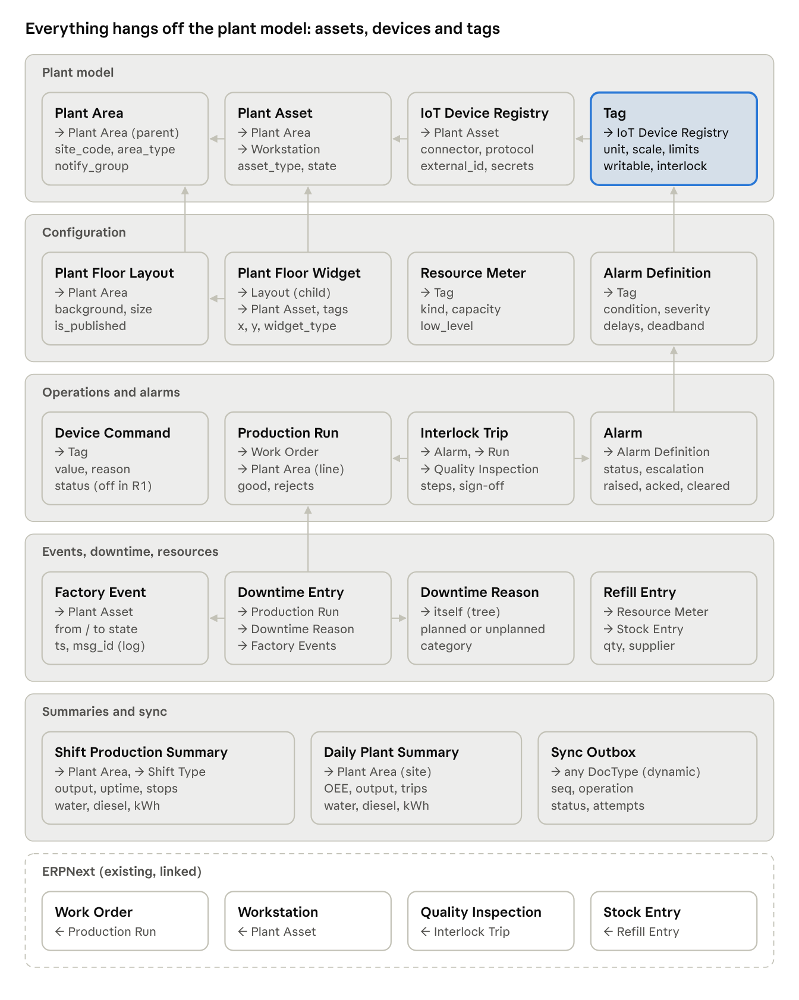

# Frappe Factory — ERD

Nov 22, 2026 · I-Varse Technologies NG

## Entity relationship diagram

Tag is the hub: devices produce tags, and alarms, meters and commands are defined on them. Production and downtime hang off ERPNext Work Orders.

Arrows point from a DocType to the one it links to (many-to-one). The arrows drawn are the main chain; every → line inside a box is a Link field to the named DocType, and ← in the ERPNext row shows which Frappe Factory DocType links to it.

## Entity reference

Key fields only; standard Frappe fields (`name`, `owner`, `creation`, `modified`, `docstatus`) are left out. → means a Link field. Naming series on edge-created documents start with the site code.

**Plant model**

| DocType | Kind | Key fields | Links to |
| --- | --- | --- | --- |
| Plant Area | Tree | `area_name`, `area_type` (Site, Area, Line, Cell), `site_code`, `notify_group` | → Plant Area (parent) |
| Plant Asset | Regular | `asset_name`, `asset_type` (Pump, Tank, Filter, Filler, Generator, Meter, PLC, Other), `current_state`, `state_since` | → Plant Area, → Workstation, → Asset (ERPNext, optional) |
| IoT Device Registry | Regular | `device_name`, `connector` (Direct, ThingsBoard), `protocol` (Modbus TCP, Modbus RTU, OPC UA, Simulator), `address`, `external_id`, `credentials` (Password), `online`, `last_seen`, `firmware` | → Plant Asset |
| Tag | Regular | `tag_key`, `label`, `unit`, `scale`, `offset`, `register_or_node`, `data_type`, `sample_ms`, `lo_lo`, `lo`, `hi`, `hi_hi`, `role` (Level, Flow, Pressure, Quality, Energy, Counter, State), `is_counter`, `is_interlock`, `writable` | → IoT Device Registry, → Plant Asset |

**Configuration**

| DocType | Kind | Key fields | Links to |
| --- | --- | --- | --- |
| Plant Floor Layout | Regular | `layout_name`, `background`, `width`, `height`, `is_published`, `published_at`, `widgets` (table) | → Plant Area |
| Plant Floor Widget | Child | `widget_type` (Asset, Value, Pipe, Label, Tank), `x`, `y`, `w`, `h`, `rotation`, `path` (for pipes), `tags` (JSON list) | → Plant Asset |
| Resource Meter | Regular | `meter_name`, `kind` (Diesel, Water, Chemical, Power), `capacity`, `unit`, `low_level` | → Tag, → Plant Asset, → Item (optional) |
| Alarm Definition | Regular | `alarm_code`, `condition` (HH, H, L, LL, State, Rate), `limit`, `severity` (Critical, High, Medium, Low), `on_delay_s`, `off_delay_s`, `deadband`, `is_interlock`, `recovery_steps` (table), `escalate_after_min` | → Tag |
| Downtime Reason | Tree | `reason_name`, `planned` (Check), `category` | → Downtime Reason (parent) |

**Operations and alarms**

| DocType | Kind | Key fields | Links to |
| --- | --- | --- | --- |
| Production Run | Submittable | `start`, `end`, `good_qty`, `reject_qty`, `rejects` (table: qty, reason), `status` | → Work Order, → Plant Area (line), → Batch (optional) |
| Factory Event | Log | `ts`, `event_type` (State, Status), `from_state`, `to_state`, `reason_code`, `msg_id` (unique) | → Plant Asset, → IoT Device Registry |
| Downtime Entry | Submittable | `start`, `end`, `duration_min`, `planned`, `comment`, `events` (table) | → Production Run, → Downtime Reason, → Plant Asset |
| Alarm | Regular | `status` (Raised, Acknowledged, Cleared, Shelved, Closed), `raised_at`, `acked_at`, `acked_by`, `cleared_at`, `shelved_until`, `shelve_reason`, `peak_value`, `repeat_count`, `escalation_level` | → Alarm Definition, → Plant Asset |
| Interlock Trip | Submittable | `tripped_at`, `readings_snapshot` (JSON), `steps` (table: step, done_by, done_at, value), `lab_value`, `signed_off_by`, `signed_off_at`, `restarted_at` | → Alarm, → Production Run, → Downtime Entry, → Quality Inspection |
| Device Command | Submittable | `value`, `action`, `reason`, `status`, `requested_by`, `approved_by`, `sent_at`, `result`, `result_at` | → Tag, → IoT Device Registry |
| Refill Entry | Submittable | `qty`, `supplier`, `level_before`, `level_after`, `delivery_note` | → Resource Meter, → Stock Entry (optional) |

**Summaries and platform**

| DocType | Kind | Key fields | Links to |
| --- | --- | --- | --- |
| Shift Production Summary | Submittable | `shift_date`, `good_qty`, `reject_qty`, `uptime_min`, `downtime_min`, `oee`, `water_l`, `diesel_l`, `kwh`, `alarms`, `trips`, `notes` | → Plant Area, → Shift Type |
| Daily Plant Summary | Regular | `date`, same totals as shift, per site | → Plant Area (site) |
| Resource Reading | Log | `ts`, `level`, `volume` (hourly from rollups) | → Resource Meter |
| Sync Outbox | Log | `seq`, `ref_doctype`, `ref_name` (Dynamic Link), `operation`, `status`, `attempts`, `last_error` | → DocType |
| Machine Telemetry | Virtual | reads TimescaleDB: `ts`, `tag`, `value`, `quality` | → Tag |
| Factory Configuration | Single | site, connector, TimescaleDB connection, retention days, `enable_commands`, sync URL and keys | — |
| OpsEdge Audit Log, OpsEdge Sync Log | Log | as today | — |

**Proposed additions (HMI symbol library, see [scada-hmi.md](scada-hmi.md)) — pending approval**

| DocType | Kind | Key fields | Links to |
| --- | --- | --- | --- |
| HMI Symbol | Regular | `symbol_name`, `category`, `svg`, `ports` (JSON: pipe connection points), `bindings` (JSON: bindable properties such as state, level, value, alarm), `version`, `is_standard` | — |
| Process Template | Regular | `template_name`, `industry`, `layout` (JSON), `assets` (JSON) | → HMI Symbol (via layout) |
| Plant Asset (new field) | — | `feeds_into` (table of downstream assets), `symbol` | → Plant Asset, → HMI Symbol |

## Data outside MariaDB

TimescaleDB holds the readings. It has no foreign keys to MariaDB; the Frappe `Tag` name is the shared key.

| Table / view | Key | Columns | Kept |
| --- | --- | --- | --- |
| `reading` (hypertable) | `(tag, ts)` | `site`, `value`, `quality` | 90 days, compressed after 3 days |
| `reading_1m` (continuous aggregate) | `(tag, bucket)` | `min`, `max`, `avg`, `last`, `n` | 2 years |
| `reading_1h` (continuous aggregate on `reading_1m`) | `(tag, bucket)` | same | forever |

The agent's local buffer is a SQLite file with the same columns as `reading`, emptied in order when TimescaleDB is reachable.
