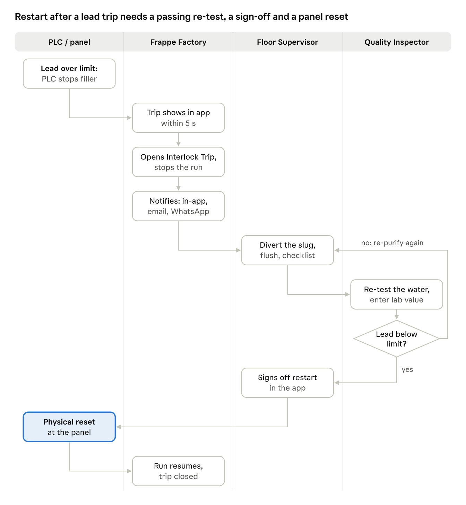
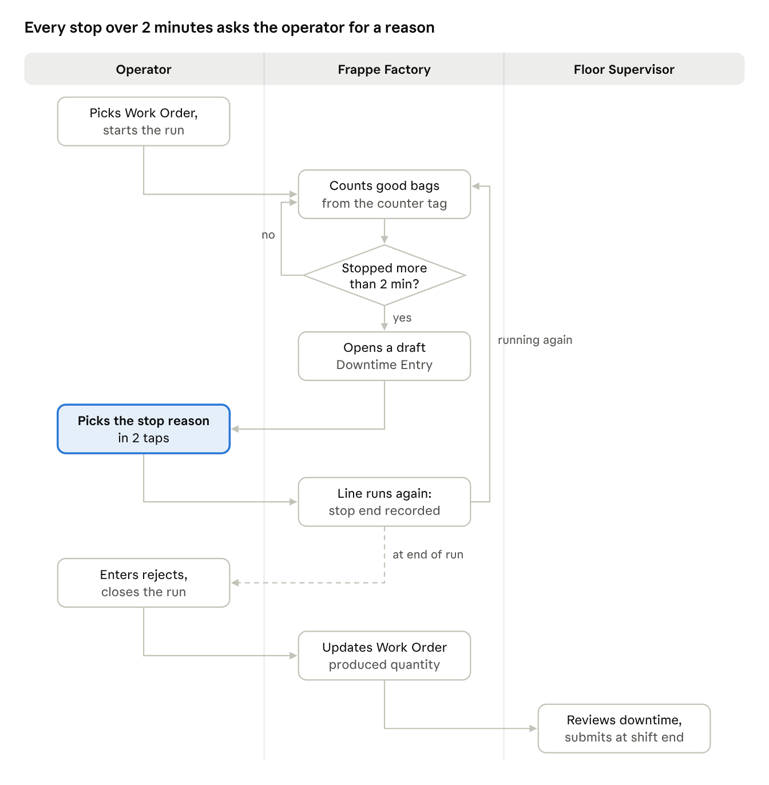
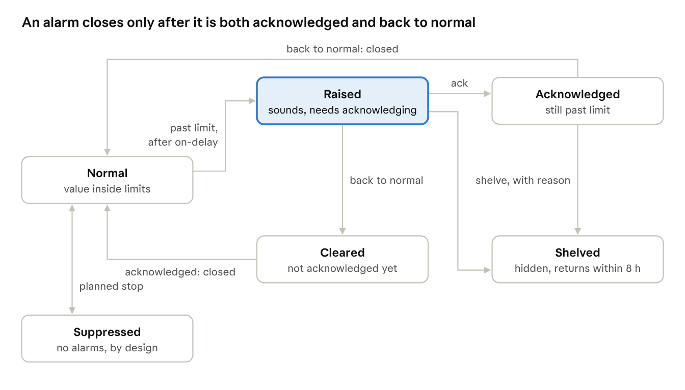
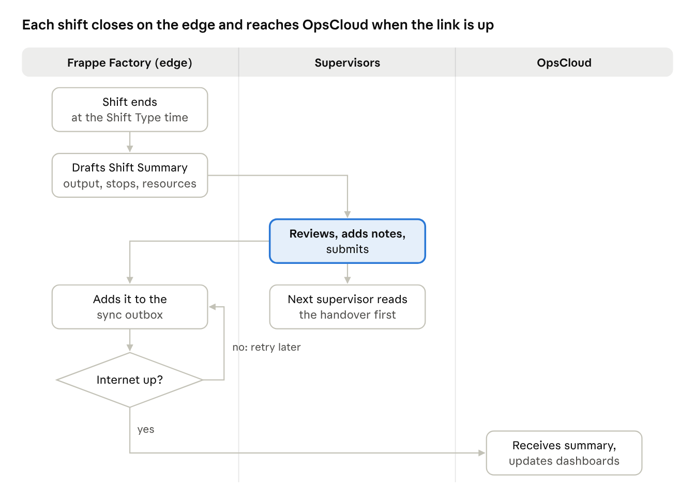

# Frappe Factory — PRD

Nov 22, 2026 · I-Varse Technologies NG

## Overview and goals

Frappe Factory gives a factory one live view of its plant, its production and its resources, connected to ERPNext. The first release proves this at the pilot site: the 10-head Koyo sachet water plant in Nigeria.

**Problem.** Small and mid-size factories run on paper logs, WhatsApp messages and memory. Supervisors find out about a stop, a low tank or a quality problem late. Downtime has no recorded reason. Fuel and water use is guessed. ERPNext knows the Work Order, but not what the machines actually did.

**Product.** An IoT-connected operations app on Frappe and ERPNext. It runs on an OpsEdge box in the factory, works without internet, and syncs to OpsCloud. Release 1 is monitor-only: it reads the plant and never controls it. The groundwork for commands is in place for a later release.

**Goals for the pilot**

| Goal | Measure | Target |
| --- | --- | --- |
| See the plant live | Time from a state change at the plant to the screen | ≤ 5 s on the factory LAN |
| No lost data | Readings lost during a 24-hour internet cut | 0 |
| Every stop explained | Downtime Entries with a reason within the same shift | ≥ 95% |
| Trips handled correctly | Lead trips with a completed recovery record before restart | 100% |
| Resources known | Fuel and water levels visible without a manual check | 100% of tanks and meters |
| Shift paperwork gone | Shift summaries produced automatically | Every shift |

## Users

Five people use the app every day at the pilot. Each one has one main job in it.

| Persona | Where they use it | Main job in the app | What they fear |
| --- | --- | --- | --- |
| **Operator** (filler line) | Tablet at the line | Start a run, record rejects, give a stop reason, acknowledge line alarms | Being blamed for a stop they did not cause |
| **Floor Supervisor** | Control-room screen, phone | Watch the plant, handle alarms and trips, close the shift | Finding out about a problem after the shift |
| **Quality Inspector** | Lab bench, tablet | Record water tests, release or hold a batch, sign off trip recovery | Bad water leaving the plant |
| **Storekeeper** | Store, phone | Record fuel and chemical deliveries, watch levels | Running out of diesel at night |
| **Factory Manager / Owner** | Phone, laptop, from anywhere | Daily output, uptime, trips, costs; approve restarts | Paying for losses they cannot see |

Supporting roles: **Maintenance Technician** (equipment alarms, asset history) and **System Manager** (setup, connector, users).

## Scope

Release 1 watches and records. It does not control any equipment.

| In release 1 | Later release | Not planned |
| --- | --- | --- |
| Live plant mimic (SCADA style) | Operator commands: start/stop, setpoints (groundwork ships in R1) | Replacing the PLC or its safety logic |
| Alarms with acknowledge, shelve, history | Predictive maintenance | Our own MQTT broker or time-series engine |
| Interlock trip recording and recovery checklist | Energy cost optimisation | Payroll or HR features |
| Production runs, counts, rejects | Cross-plant benchmarking reports (OEE ranked across plants) | |
| Downtime with reasons | Native mobile app | |
| Tanks, fuel, water, power monitoring | | |
| Shift and daily summaries | | |
| Notifications: Frappe in-app, email, WhatsApp (`frappe_whatsapp_openwa`) | | |
| Edge box works offline, syncs to OpsCloud | | |
| Direct connector and ThingsBoard connector | | |
| Several plants in one app: a Plants home with one card per plant, each opening that plant | | |

The pilot PLC and its protocol (Modbus TCP, Modbus RTU or OPC UA) are not chosen yet. The driver layer supports all three, so the choice does not block the build.

## User stories

Stories are grouped by epic. IDs are used in the TRD, the tests and the screen designs.

**E1 · Live plant**

| ID | Story | Acceptance criteria |
| --- | --- | --- |
| US-101 | As a Supervisor, I want a live mimic of the plant so that I see what is running without walking the floor | Every pump, tank, filter and filler shows its state and main values. Updates within 5 s. Pipes show flow when the upstream pump runs |
| US-102 | As a Supervisor, I want to open any machine and see its recent trend so that I can see what led to a problem | Click on a machine opens its detail: tags, last 24 h trend, last 20 events |
| US-103 | As a Manager, I want to draw the plant layout once so that the mimic matches our real plant | Drag assets onto a canvas, bind tags, draw pipes, publish. Only one published layout per area |
| US-104 | As anyone, I want to see when data is old so that I do not trust a frozen screen | A value older than 3× its sample rate is greyed with its age. A device offline shows a banner |
| US-105 | As a Manager, I want every plant we run listed on one home screen so that I open the one that needs me | The app opens on Plants: one card per plant I may see, with state (Tripped, Alert, Offline, Running), a one-line reason, output and last seen. Problem plants come first. Clicking a card opens that plant's own screens; nothing from other plants shows there. New plants appear once added |
| US-106 | As a Manager, I want to know when a plant stops reporting so that I don't read old figures as live | No status for 60 s marks the card Offline with the time last seen and its last known figures greyed. The plant keeps running and recording on its edge box and syncs when the link returns |

**E2 · Alarms and trips**

| ID | Story | Acceptance criteria |
| --- | --- | --- |
| US-201 | As an Operator, I want alarms on my line to show on my tablet so that I react fast | New alarm shows with sound within 5 s. Sorted by severity, then age |
| US-202 | As a Supervisor, I want to acknowledge, shelve and comment on alarms so that the list shows only what needs action | Shelve needs a reason and a time limit (max 8 h). All actions logged with user and time |
| US-203 | As a Supervisor, I want a lead trip to open a recovery checklist so that we never restart with bad water | Trip opens an Interlock Trip with readings, stops the run, notifies. Restart button disabled until checklist done and signed |
| US-204 | As a Quality Inspector, I want to record the re-test result inside the trip so that the recovery has proof | Lab value field with limit check. Below limit required for sign-off |
| US-205 | As a Manager, I want trips and critical alarms on WhatsApp so that I know even when I am away | Critical events go to in-app, email and WhatsApp per Notification settings. One message per event, not per repeat |

**E3 · Production and downtime**

| ID | Story | Acceptance criteria |
| --- | --- | --- |
| US-301 | As an Operator, I want to start a run from a Work Order so that output is counted against it | Pick from open Work Orders for my line. Start time from the machine state when available |
| US-302 | As an Operator, I want counts to come from the machine and record rejects by hand so that the numbers are right | Good count from the counter tag. Rejects entered with a reason. Totals update the Work Order on run close |
| US-303 | As an Operator, I want to give a reason when the line stops so that stops are explained | A stop longer than 2 min opens a Machine Stop. Reason picked from a tree in 2 taps |
| US-304 | As a Supervisor, I want to review and correct downtime so that the records are right | Edit reason, split or merge stops before shift close. Submitted entries are read-only |

**E4 · Resources**

| ID | Story | Acceptance criteria |
| --- | --- | --- |
| US-401 | As a Storekeeper, I want to see diesel and water levels so that we never run out | Each tank shows level, volume, hours left at current use. Low alarm at a set level |
| US-402 | As a Storekeeper, I want to record a fuel delivery so that stock and cost are right | Refill Entry with quantity and supplier. Level rise is checked against the entry. Optional Stock Entry in ERPNext |
| US-403 | As a Manager, I want water, fuel and power use per shift so that I know my cost per bag | Shift summary shows litres produced, litres of water in, diesel used, kWh, and use per 1,000 bags |

**E5 · Shift and reports**

| ID | Story | Acceptance criteria |
| --- | --- | --- |
| US-501 | As a Supervisor, I want the shift to close with a summary so that the handover is quick | At shift end, a summary is drafted: output, uptime, stops, alarms, trips, resources. Supervisor adds notes and submits |
| US-502 | As the next Supervisor, I want to read the handover so that I know open issues | Open alarms, shelved alarms, open trips and notes shown first when I start |
| US-503 | As a Manager, I want a daily dashboard so that I see the plant in one minute | OEE, output, uptime, top 5 stop reasons, trips, resources. Works on phone |

**E6 · Setup and operations**

| ID | Story | Acceptance criteria |
| --- | --- | --- |
| US-601 | As a System Manager, I want to add a device and its tags so that new sensors show up | Add device, pick connector and protocol, add tags with units and limits, test read |
| US-602 | As a System Manager, I want the plant to keep working offline so that internet cuts do not matter | All floor functions work without internet. Sync resumes and catches up in order |
| US-603 | As a System Manager, I want to see sync and device health so that I fix problems early | Devices online/offline with last seen. Sync backlog and last success time |

**E7 · Kiosk, ERPNext link and other systems**

| ID | Story | Acceptance criteria |
| --- | --- | --- |
| US-701 | As a Factory Manager, I want to assign people to a kiosk so that only they can use that station | A Kiosk Profile lists its plant, machines, allowed actions and assigned users. Sign-in lists only assigned users. A user needs the action's role as well as the assignment |
| US-702 | As a Floor Supervisor, I want to open the kiosk for my shift so that the line tablet is ready and locked | Opening works only on the registered tablet, for kiosks the supervisor is assigned to, and goes full screen. Leaving needs a Floor Supervisor's Frappe user and PIN. Closing writes the session to the shift handover |
| US-703 | As an operator, I want to sign in with my Frappe user and PIN so that what I enter carries my name | Tap your Frappe user, then a 6-digit PIN checked against that user. A PIN alone signs no one in; users without a PIN can't sign in. 5 wrong PINs lock that user on every kiosk for 15 min; idle 10 min returns to the name screen |
| US-704 | As a company without ERPNext, I want Frappe Factory to work on its own so that I get a full IoT and SCADA platform | Installs on plain Frappe. Plants, devices, live screens, alarms, trips, stops, trends, resources, handover, kiosk and API all work. Anything that needs ERPNext is hidden, not broken |
| US-705 | As a company on ERPNext, I want to link it on the same site or another site so that production follows our work orders | Settings → ERPNext: same site, or site URL with API key and secret plus Verify connection. Each link (work orders, stock, downtime, workstation status, quality, material requests, HRMS) is its own switch. Failures are listed under Logs |
| US-706 | As a company on another ERP, I want to connect through the API so that our ERP keeps its role | Frappe user API keys (each key has its user's roles and plants); documented REST methods; Frappe Webhooks for shift summaries, stops, trips and alarms; plan targets can be posted in |
| US-707 | As a Factory Manager, I want one dashboard for factory and manufacturing so that I see the whole operation | Factory metrics always; Manufacturing metrics (work orders, completions, shortages, quality, plan) appear when ERPNext is linked |
| US-708 | As a Maintenance Technician, I want a kiosk view for my area so that I see equipment faults and my jobs without a desk | Maintenance view shows equipment status, my open jobs, equipment alarms to acknowledge, fault reports and spare-part requests. It never resets an interlock |
| US-709 | As a Quality Inspector, I want a kiosk view in the lab so that I respond to quality faults fast | Quality view shows live quality analysers, the open hold and its lots, routine checks due, sample entry and QA release. Every entry is signed with the Frappe user and PIN |
| US-710 | As a poultry farm manager, I want my feed mill, layer houses and egg room in the same app so that I watch climate, feed, water and eggs together | Poultry farm template: house temperature, humidity, ammonia, fans and pads per house; feed bin and water runway; eggs counted in eggs and trays of 30; lay rate and mortality; its own layout editor |
| US-711 | As a Factory Manager or Machine Operator, I want to say which machine feeds which so that layouts, stops, alarms and holds follow the real flow | Process flow page per plant: each asset's Feeds into, carried medium and return links; checks for loops and dead ends; Generate layout opens a draft in the layout editor; stops downstream of a stopped asset are logged as starved |

**E8 · Quality assurance**

| ID | Story | Acceptance criteria |
| --- | --- | --- |
| US-801 | As a Quality Inspector, I want to release the line myself after a quality fault so that filling only restarts on human test results | A quality-related trip has a QA release step after the samples. Release needs the inspector's Frappe user and PIN and the template's results. Sensor readings alone never satisfy it. Restart is blocked until it is done |
| US-802 | As a Quality Inspector, I want everything made around a fault held so that suspect product never leaves | A Quality Hold opens with the trip and holds lots made since the last passing check, split by time. Held stock can't be dispatched; with ERPNext the batch is disabled |
| US-803 | As a Quality Inspector, I want to decide each held lot so that good product is saved and bad product is scrapped | Decisions: Release, Release with deviation (Factory Manager too), Rework or reprocess, Scrap. The hold closes only when every lot is decided |
| US-804 | As a Factory Manager, I want QA rules per product so that a rice mill and a water plant each test what matters | Quality Hold Templates per product or fault: tests, sample count, limits, default decisions; shipped with each Process Template |
| US-805 | As a Factory Manager, I want counts in the machine unit and the pack unit so that nobody confuses a sachet with a bag | The Process Template sets machine unit, pack unit and conversion (sachet water: 20 × 50 cl sachets = 1 bag). Rates and rejects in sachets, output and plans in bags, holds in both plus litres; loose sachets shown on their own |

## Workflow: lead trip and recovery

Covers US-203, US-204 and US-205.

The PLC stops production on its own. The app records, notifies and guides the recovery. Restart needs three things: a passing re-test, a sign-off in the app and a physical reset at the panel. The app never sends the reset.

## Workflow: production run and downtime

Covers US-301 to US-304.

The machine counts, and the operator explains. A stop over 2 minutes opens a draft Machine Stop that needs a reason. The supervisor reviews and submits all entries before the shift closes.

## Workflow: alarm lifecycle

Covers US-201 and US-202.

An alarm that clears by itself still waits for an acknowledgement, so nobody misses a short event. Shelving needs a reason and comes back after at most 8 hours. Suppression is set by design, for example during a planned stop, never by hand during a shift.

## Workflow: shift close, handover and sync

Covers US-501, US-502, US-503 and US-602.

The handover works on the edge without internet. The summary waits in the outbox and reaches OpsCloud when the link is back, in order.

## Non-functional requirements

| Area | Requirement |
| --- | --- |
| Safety | The app never sits in a safety trip path. Release 1 sends no command to any device |
| Latency | State and alarm on screen ≤ 5 s after the PLC changes, on the factory LAN |
| Offline | All floor functions work with no internet. 7 days of edge buffering without data loss |
| Data | Raw readings kept 90 days on the edge, 1-minute rollups 2 years, summaries forever |
| Scale (per site) | Up to 500 tags at 1 s sampling on one OpsEdge box |
| Availability | Edge services restart by themselves after a power cut. Generator change-over must not corrupt data |
| Security | Role-based access, area-scoped users, audit log of every alarm and trip action, no guest endpoints on the Direct connector |
| Platform | Frappe and ERPNext v15 and v16 |
| Usability | Kiosk targets ≥ 48 px, readable at 1 m, works with gloves. English first; translatable strings throughout |
| Licence | Commercial licence owned by I-Varse Technologies |

## Pilot release criteria

The Koyo pilot is accepted when all of these are true for 14 days in a row of real production:

- [ ] Every tag on the plant reads on the mimic, with no value older than its limit while the device is online
- [ ] A 24-hour internet cut causes no lost readings, events or documents
- [ ] A trip drill at the panel shows in the app within 5 s, stops the run, sends WhatsApp, and blocks restart until sign-off
- [ ] ≥ 95% of stops have a reason within the shift
- [ ] Every shift closes with a summary and syncs to OpsCloud
- [ ] Supervisors use the app instead of the paper log (paper log retired)
- [ ] No open high-severity finding from the app audit
