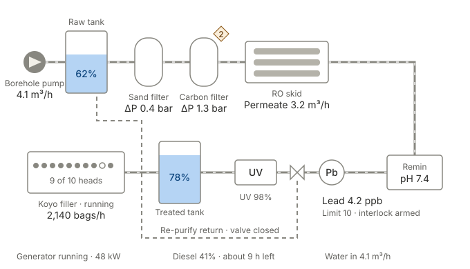

# Frappe Factory — SCADA and HMI

Nov 22, 2026 · I-Varse Technologies NG

## Which SCADA we use

We do not use an off-the-shelf SCADA package. **Frappe Factory is the SCADA**, built from the parts chosen in [architecture.md](architecture.md). In release 1 it is a monitoring SCADA: everything except control is live, and control is a configuration switch away (see the command groundwork in [trd.md](trd.md)).

### SCADA stack

| SCADA job | Frappe Factory component | Release 1 status | Notes |
| --- | --- | --- | --- |
| Talk to the PLCs and collect data | OpsEdge Agent | Live | Modbus TCP, Modbus RTU and OPC UA drivers |
| Move data around the plant | Mosquitto (MQTT broker) | Live | Local broker on the OpsEdge box |
| Store history (historian) | TimescaleDB | Live | Raw readings 90 days, rollups kept longer |
| Alarms | Frappe Factory alarm engine | Live | Alarm Definition, Alarm, Interlock Trip |
| Operator screens (HMI) | SVG mimic in the Vue app | Live | ISA-101 style plant screens |
| Supervisory control (commands) | Command groundwork | Built, switched off | Turned on later by configuration |

### Alternatives considered

| Option | Cost / licence | Decision | Reason |
| --- | --- | --- | --- |
| FUXA | Free, MIT | Not used | A second system beside Frappe, with its own users, devices and history |
| Ignition / AVEVA | Per-site licences | Not used | Licence cost hurts pricing for small factories |
| ThingsBoard | BSL 1.1 from v4.4 | Optional connector | Licence change; kept behind the connector interface |
| Customer's existing SCADA | Customer's own | Supported as data source | Plugs in through the connector interface; Frappe Factory still runs production, downtime, trips and reports |

Any off-the-shelf SCADA would duplicate what Frappe already does and could not link a screen to a Work Order, Downtime Entry or Interlock Trip without glue code. Building on Frappe keeps the product white-label and sellable under the I-Varse commercial licence.

## How equipment is shown

The screens follow **ISA-101**, the standard for high-performance HMI: the plant is drawn in calm greys, and colour appears only when something needs attention.

*Sketch of the Koyo line: borehole pump, raw tank, sand and carbon filters, RO skid, remineralization, lead analyser with interlock, divert valve, UV, treated tank and the 10-head Koyo filler, with the re-purify return line. The order of stages is to be confirmed against the real plant.*

- **Symbol library.** Our own SVG symbols in a P&ID style: pump, tank, filter vessel, RO skid, dosing unit, UV, valve, analyser, filler, generator, fuel tank. Each symbol is a Vue component that takes a state and values and draws itself.
- **States by shape, not colour:**
  - Running: solid fill.
  - Stopped: outline.
  - Offline: hatched, with a "no data" label.
  - Stale (older than 3× its sample rate): greyed, with its age shown.
  - Alarm: a small amber or red diamond with its priority number.
  - Lead trip: the analyser and divert valve turn red and the trip screen opens.
- **Flow.** Pipes animate only when the upstream pump runs and the flow tag is above zero. The re-purify return comes alive when the divert valve opens after a trip.
- **Levels and values.** Tanks fill to their real level. Every number shows its unit. Clicking equipment opens a detail panel with a 24-hour ECharts trend and recent events.
- **Four screen levels (ISA-101):**
  1. Plant overview.
  2. Process area (for example the treatment train).
  3. One machine.
  4. Diagnostics.
- **Designer.** A manager drags symbols onto a canvas, snaps pipes between connection points and links each symbol to its asset and tags. Saved as the Plant Floor Layout. No code is needed.
- **Live updates.** Tag values arrive over Frappe realtime, at most once per second per tag, and the screen redraws in batches.

## Deploying to other companies: the symbol library

We do **not** draw SVGs per company. The library is built once and each company's plant is assembled from it as configuration.

**How a new company gets its plant screen**

1. **Generated automatically.** Each Plant Asset has a type (pump, tank, RO, filler…) and a "feeds into" link to the next asset. The app draws a working mimic from that with an auto-layout library (for example dagre, MIT). No drawing needed.
2. **Industry templates.** Ready layouts for sachet water, bottled water, bakery, juice and so on. The Koyo plant becomes the first sachet-water template.
3. **Designer.** Drag symbols, adjust pipes, link tags, for customers who want it to match their real floor.
4. **Custom symbol upload.** For rare equipment. Any SVG works if it follows our naming rule (elements named such as `ff-body`, `ff-level`, `ff-value`, plus pipe connection points). An integrator can make one in Inkscape or Figma without code.

**Where the library lives.** OpsCloud holds the master copy. Each symbol is a record (SVG, connection points, bindable properties). Edge sites pull it like other master data, so a newly published symbol reaches every customer's box on its next sync, and old versions stay available so existing screens don't break.

**Where the symbols come from**

| Source | What you get | Catch |
| --- | --- | --- |
| Draw our own (recommended) | ~40 ISA-101 symbols cover most factories | Design time, but owned outright: no attribution, one consistent style |
| draw.io | Large process engineering library; code is Apache 2.0 | Icons and stencils are CC BY 4.0 (attribution required); P&ID line drawings need reworking for live states |
| chempid | P&ID symbols per ISO 10628-2, MIT licence | LaTeX graphics, not SVG; reference only |
| Open Automation Software | Free HMI graphics (manufacturing, HVAC, water) | Download behind a form; licence for reuse in a product not public |
| Symbol Factory (commercial) | 5,000+ industrial graphics, $695 perpetual licence | Commercial use needs a licence; redistribution inside our product may need a separate agreement |

**Recommendation.** Draw our own core set of about 40 symbols during the design phase. Use draw.io and chempid only as shape references. The upload path covers anything unusual.

**Approved (22 Nov 2026):** the `HMI Symbol` record type, with its Port and Binding child tables, a `symbol` link on Plant Floor Widget and an optional `default_symbol` on Plant Asset. Specification in [trd.md](trd.md#hmi-symbol-library), fields in [erd.md](erd.md).

**Approved 22 Nov 2026:** the `Process Template` DocType (industry templates).

**Approved 22 Nov 2026:** the `feeds_into` link on Plant Asset. See the TRD, Process flow (feeds into). Nothing in this doc is pending any more.
