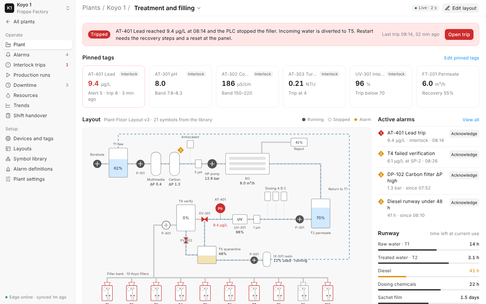
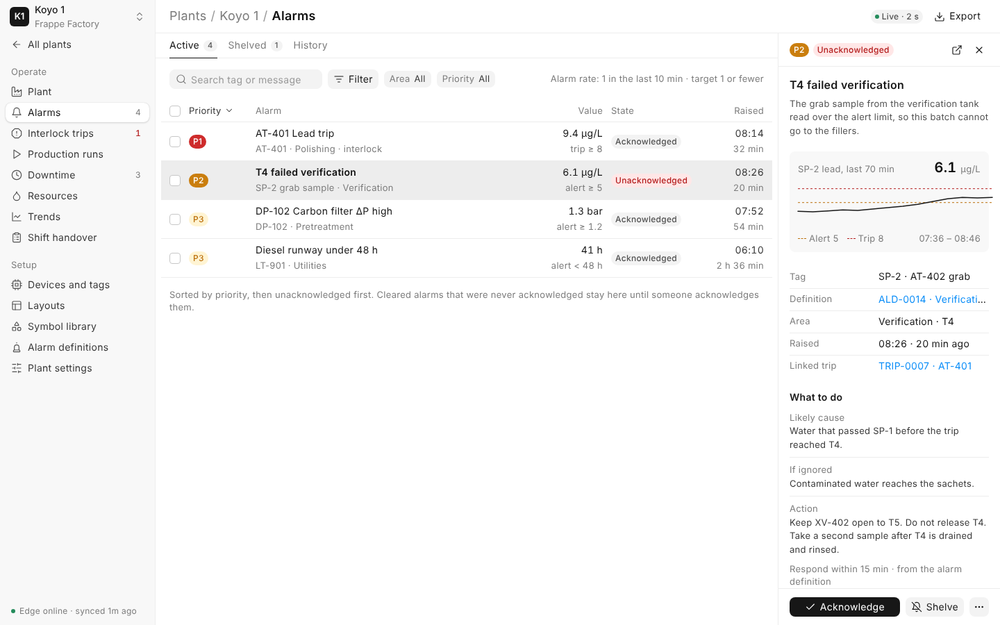
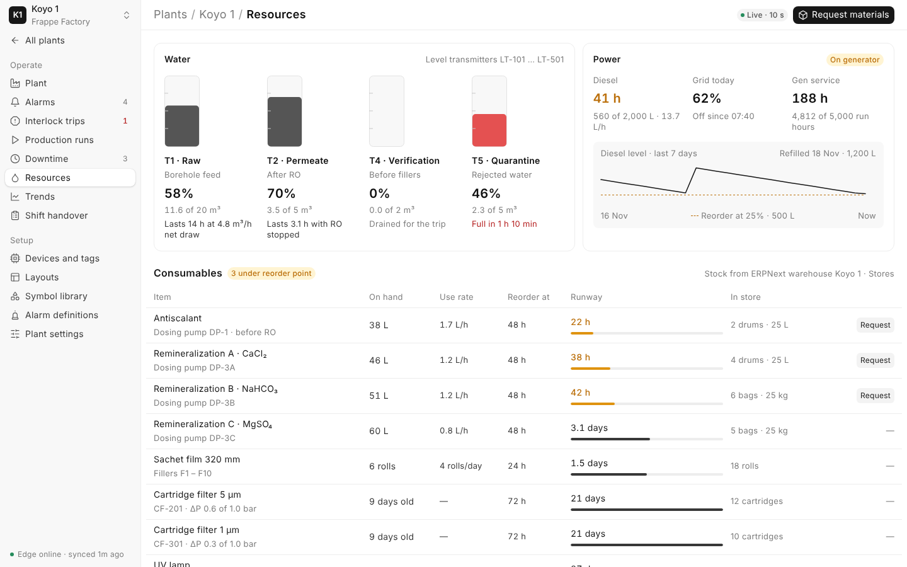
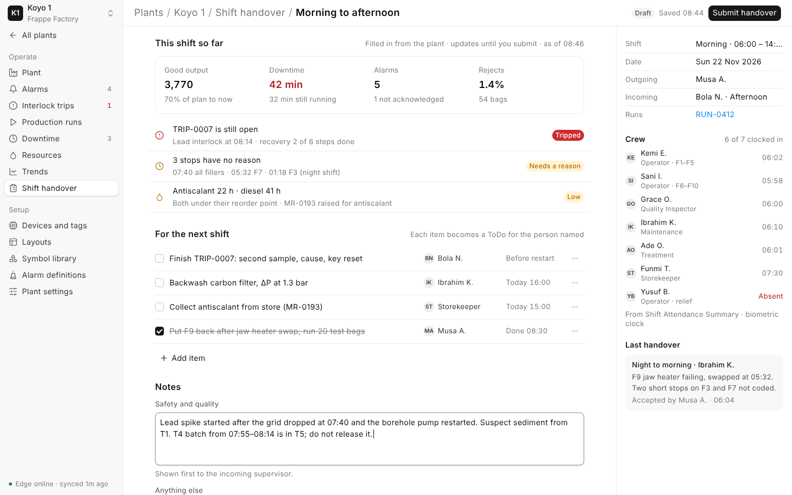
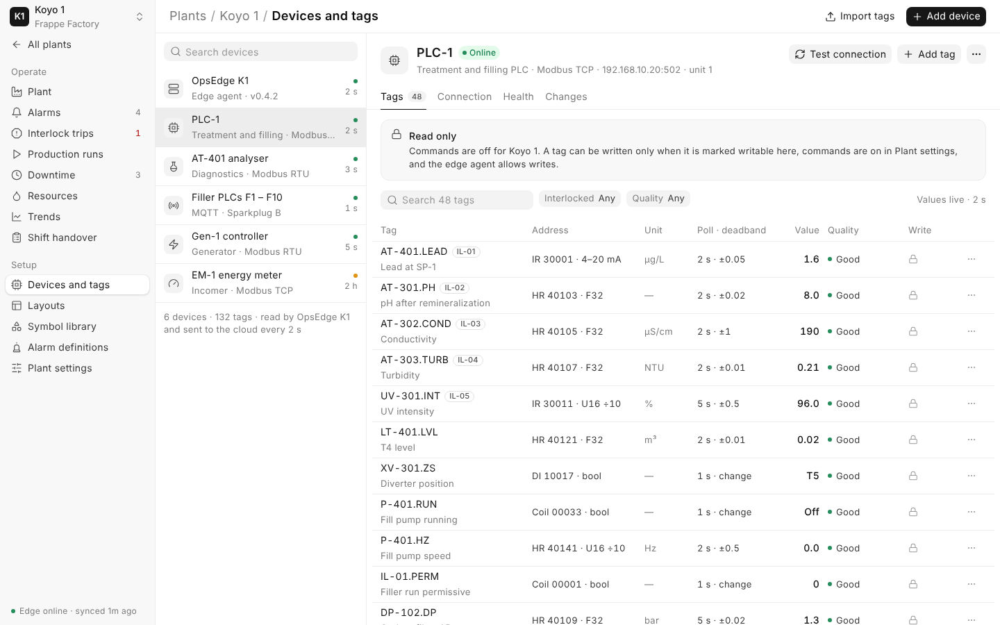
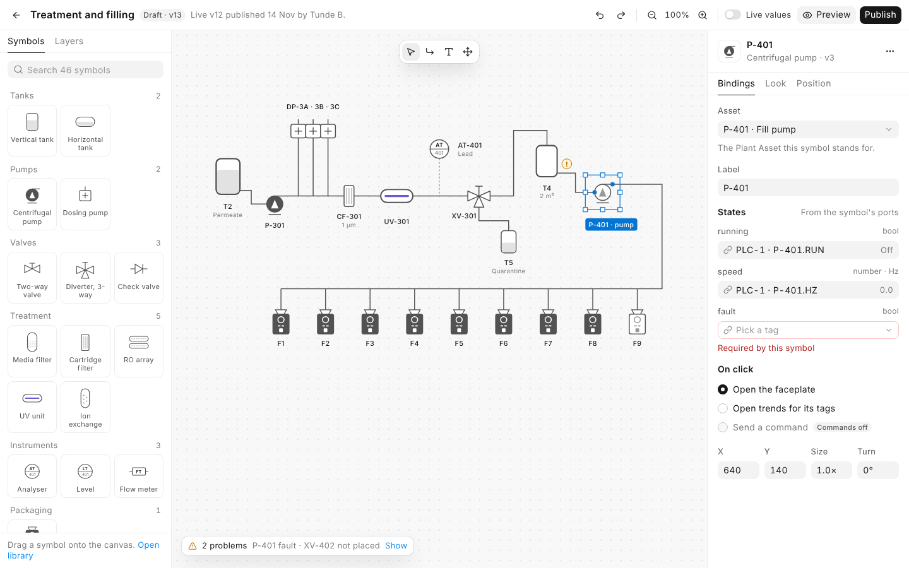
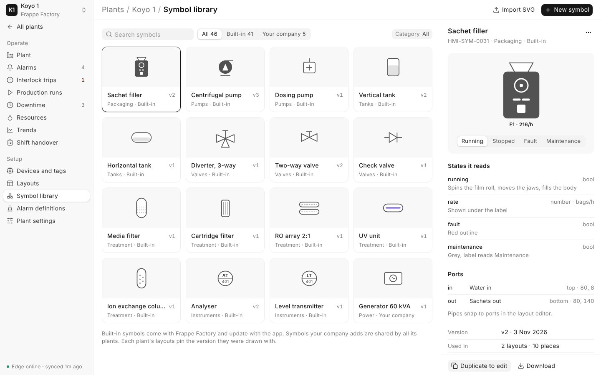

# Screens

Frappe Factory screen designs, built on frappe-ui. Live, clickable version: [Frappe Factory — screens](https://claude.ai/artifact/8NiCgasgTHvjFr3z7civXz). The board sources are in [design/boards](design/boards) and the scripts that generate them in [design/build](design/build).

Every screen shows the same moment: Koyo 1 at 08:46 on 22 Nov, 32 minutes after the lead interlock tripped. Koyo 1 is the real pilot; Plants B, C and D are sample data. Tag addresses and protocols on Devices and tags are sample values until the PLC protocol is chosen.

Each board is a 1440 × 900 laptop screen. The sidebar stays fixed and only scrolls if its own items outgrow the screen; the page body scrolls under a fixed header.

## 0 · Plants

## 1 · Plant (live)

## 2 · Alarms

## 3 · Interlock trip recovery

## 4 · Production runs

## 5 · Run detail

## 6 · Downtime

## 7 · Resources

## 8 · Trends

## 9 · Shift handover

## 10 · Devices and tags

## 11 · Layout editor

## 12 · Symbol library

## 13 · Alarm definitions

## 14 · Plant settings · connector

## 15 · Plant settings · commands

