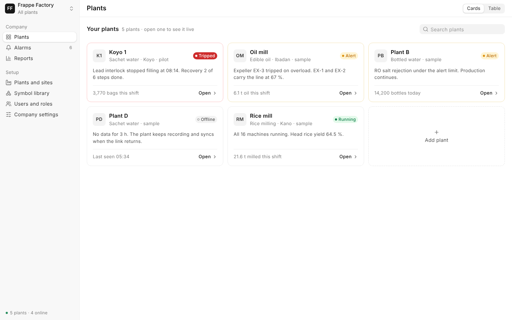
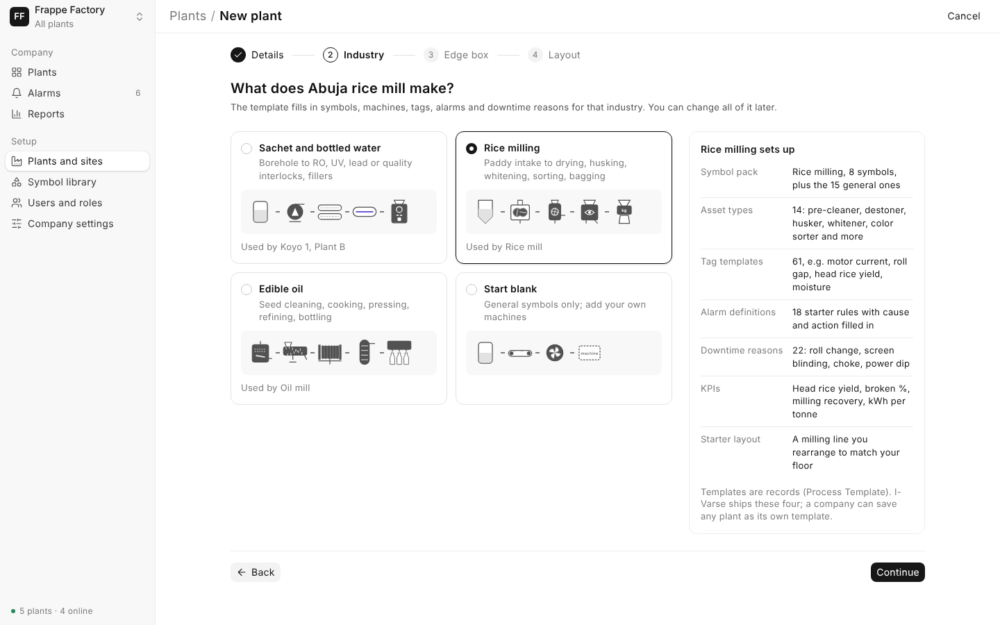
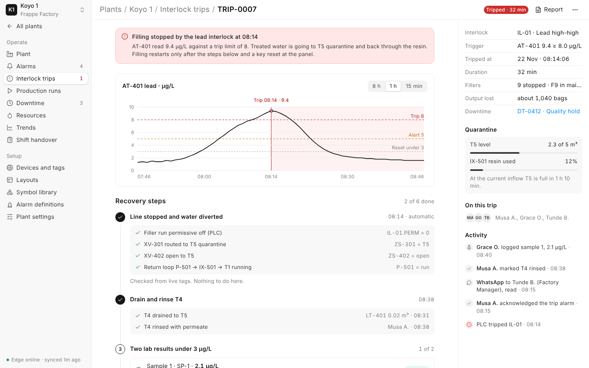
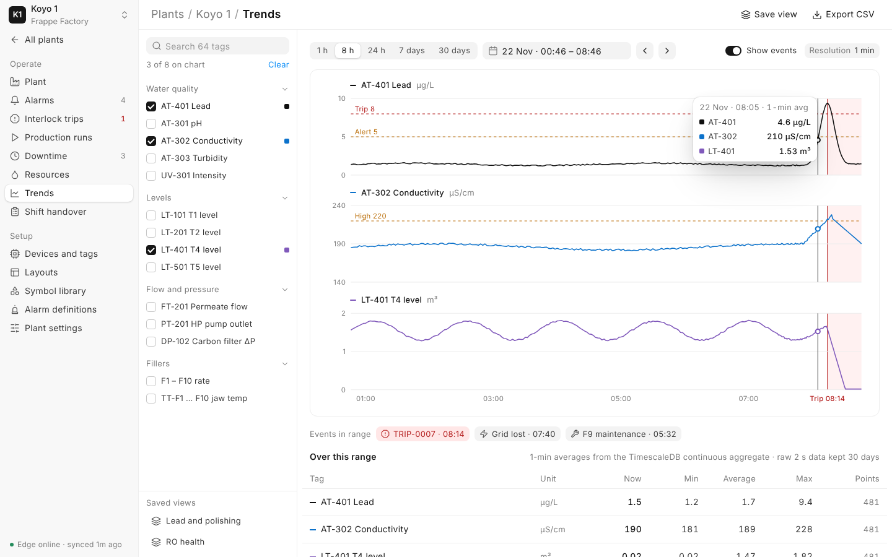
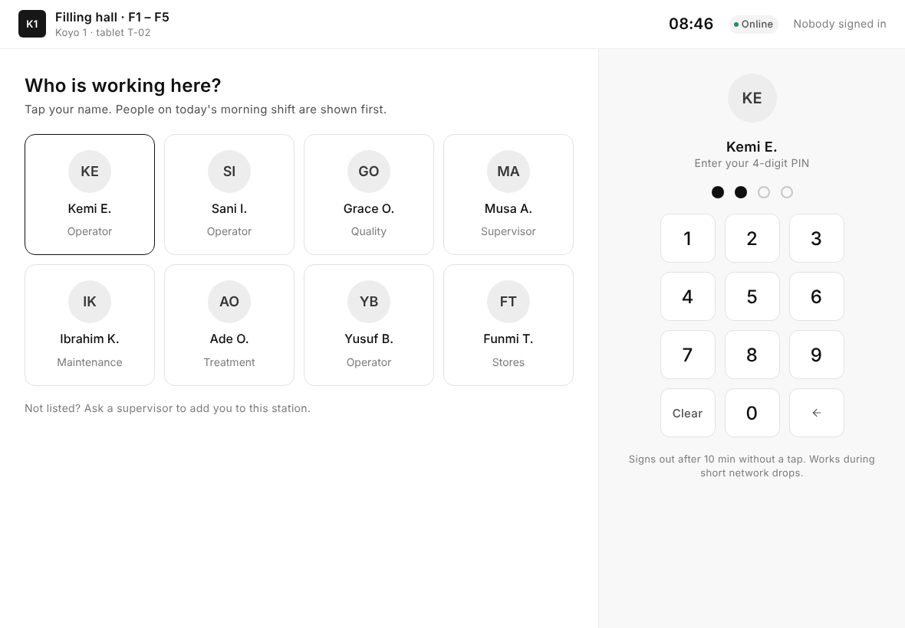
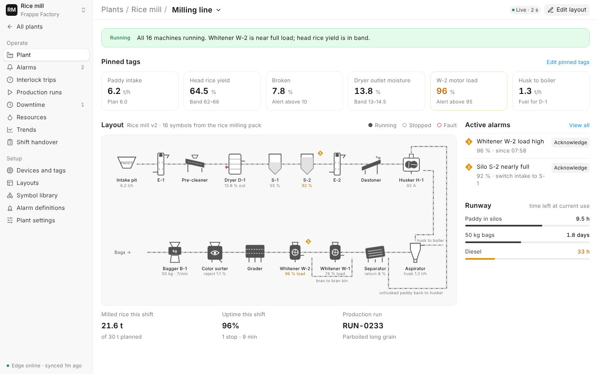
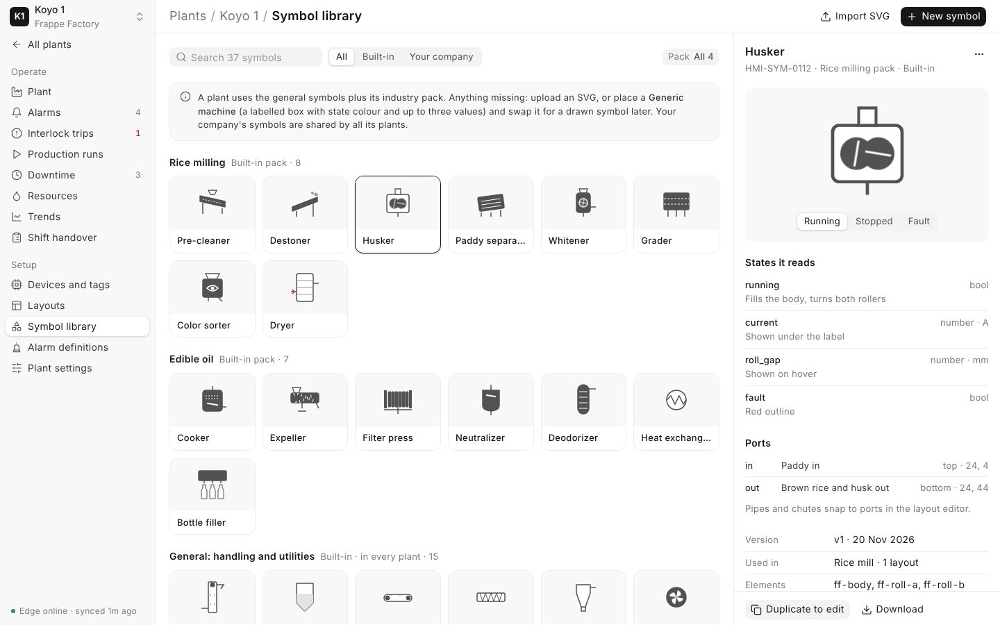
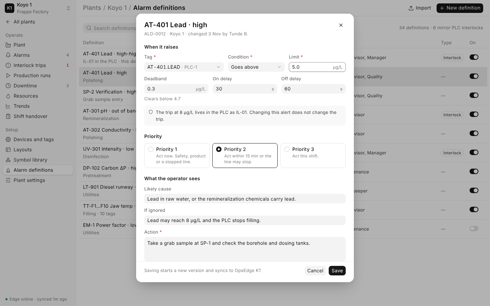
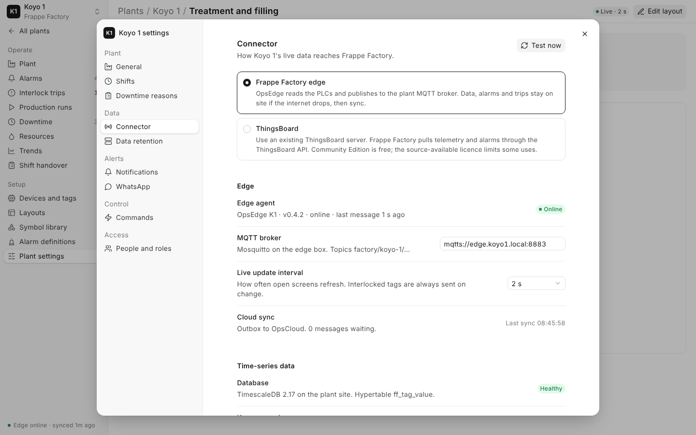

# Screens

Frappe Factory screen designs, built on frappe-ui. Live, clickable version: [Frappe Factory — screens](https://claude.ai/artifact/8NiCgasgTHvjFr3z7civXz). Board sources are in [design/boards](design/boards); the scripts that generate them are in [design/build](design/build).

The main story is Koyo 1 at 08:46 on 22 Nov, 32 minutes after the lead interlock tripped. Koyo 1 is the real pilot; every other plant is sample data. The rice mill and oil mill show the same plant screen drawn from other industry symbol packs. Tag addresses and protocols on Devices and tags are sample values until the PLC protocol is chosen.

Every desktop screen uses one Sidebar component: the company version on Plants and New plant, the plant version inside a plant. It stays fixed and only scrolls if its own items outgrow the screen; the page body scrolls under a fixed header. Desktop boards are 1440 × 900. The floor kiosk is a 1180 × 820 tablet with no sidebar, by design.

## 0 · Plants (home)

## 1 · New plant · choose industry

## 2 · Plant · Koyo 1 (live)

## 3 · Alarms

## 4 · Interlock trip recovery

## 5 · Production runs

## 6 · Run detail

## 7 · Downtime

## 8 · Resources

## 9 · Trends

## 10 · Shift handover

## 11 · Kiosk · sign in with PIN

## 12 · Kiosk · line view

## 13 · Plant · Rice mill

## 14 · Plant · Oil mill

## 15 · Devices and tags

## 16 · Layout editor

## 17 · Symbol library · industry packs

## 18 · Alarm definitions

## 19 · Plant settings · connector

## 20 · Plant settings · commands

