# Screens

Frappe Factory screen designs, built on frappe-ui. Live, clickable version: [Frappe Factory — screens](https://claude.ai/artifact/8NiCgasgTHvjFr3z7civXz). Board sources are in [design/boards](design/boards); the scripts that generate them are in [design/build](design/build).

Production runs, run detail and the Manufacturing half of the Dashboard need ERPNext linked; everything else works standalone. The main story is Koyo 1 at 08:46 on 22 Nov, 32 minutes after the lead interlock tripped. Koyo 1 is the real pilot; every other plant is sample data. The rice mill and oil mill show the same plant screen drawn from other industry symbol packs. Tag addresses and protocols on Devices and tags are sample values until the PLC protocol is chosen.

Every desktop screen uses one Sidebar component. At the top is the app menu (brand and user), opening Apps on this site, Open kiosk, Switch to Desk, help, theme, settings and log out, as in Frappe CRM and Helpdesk. Below it come the company items, or, inside a plant, the plant switcher and plant items. It stays fixed and only scrolls if its own items outgrow the screen; the page body scrolls under a fixed header. Desktop boards are 1440 × 900. The floor kiosk is a 1180 × 820 tablet with no sidebar, by design.

## 0 · Dashboard · factory and manufacturing

## 1 · App menu open (apps, Desk, kiosk)

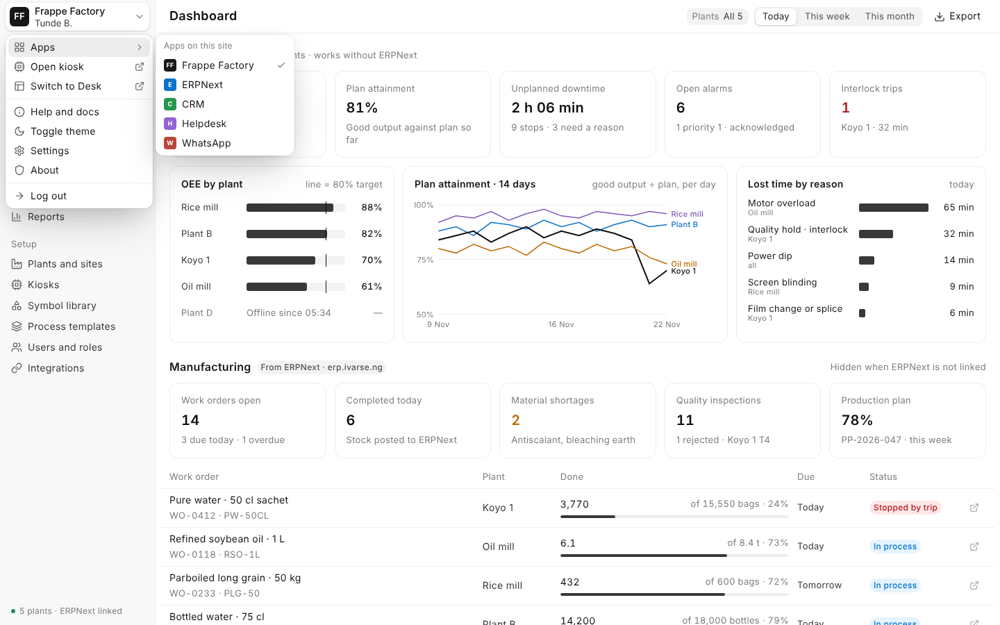

## 2 · Plants

## 3 · New plant · choose industry

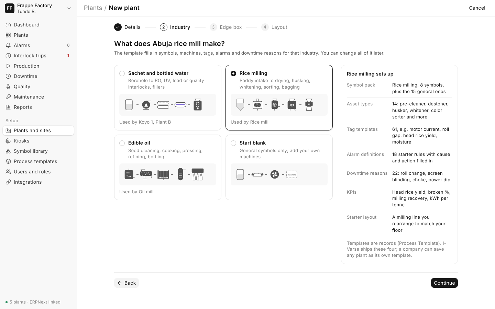

## 4 · Settings · ERPNext

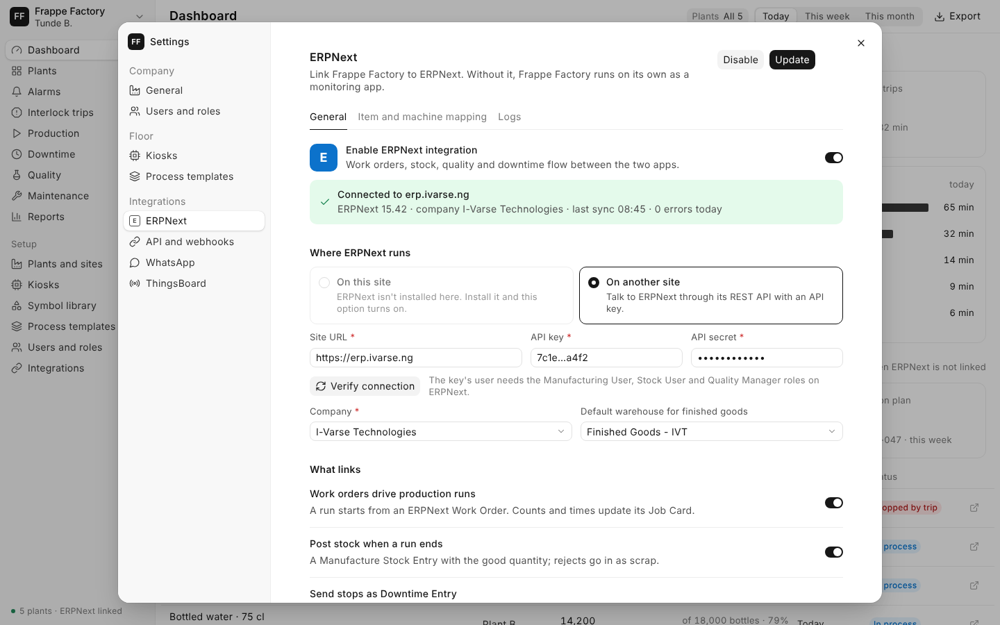

## 5 · Settings · API and webhooks

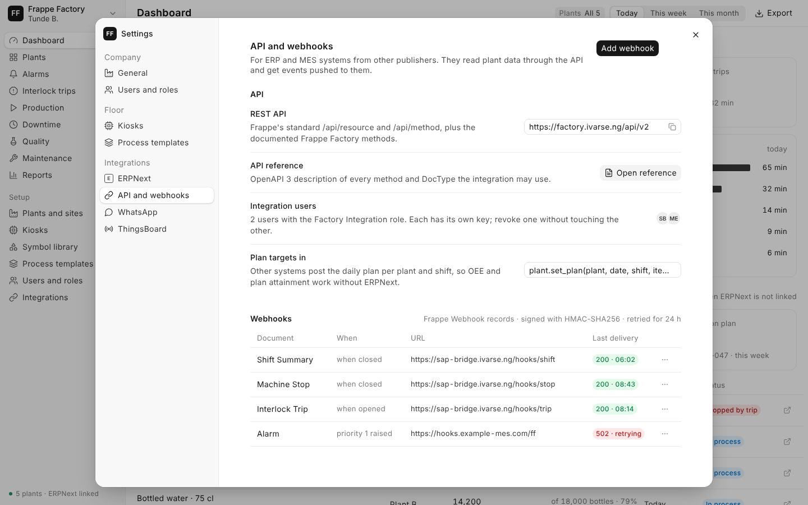

## 6 · Settings · Kiosks and assigned users

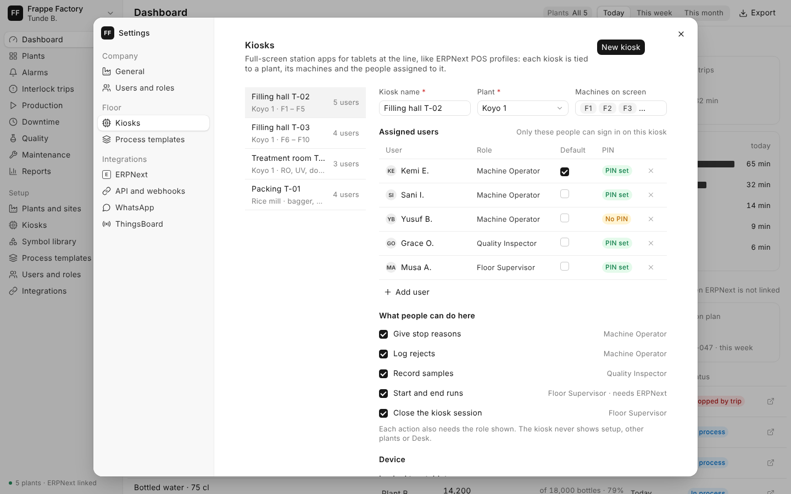

## 7 · Plant · Koyo 1 (live)

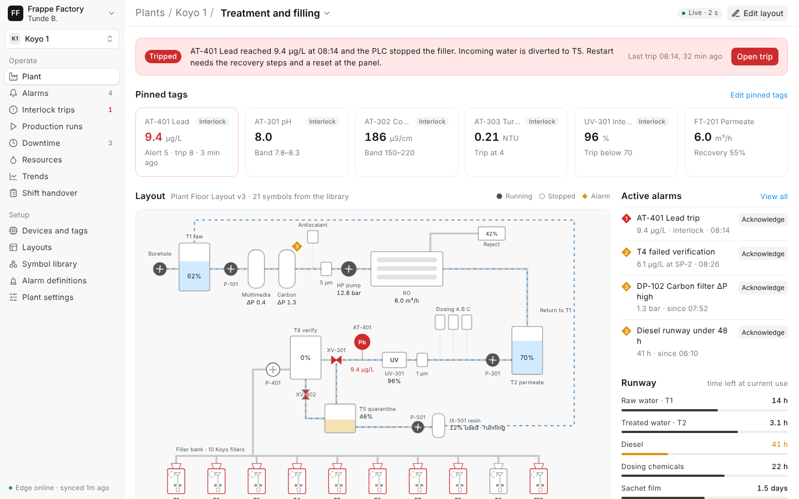

## 8 · Alarms

## 9 · Interlock trip recovery

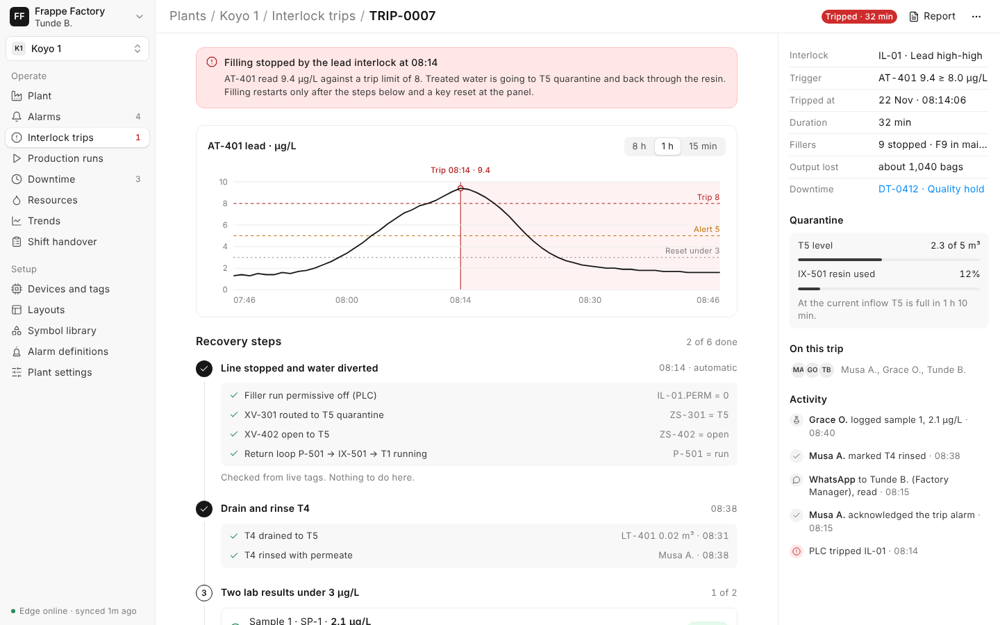

## 10 · Production runs · needs ERPNext

## 11 · Run detail · needs ERPNext

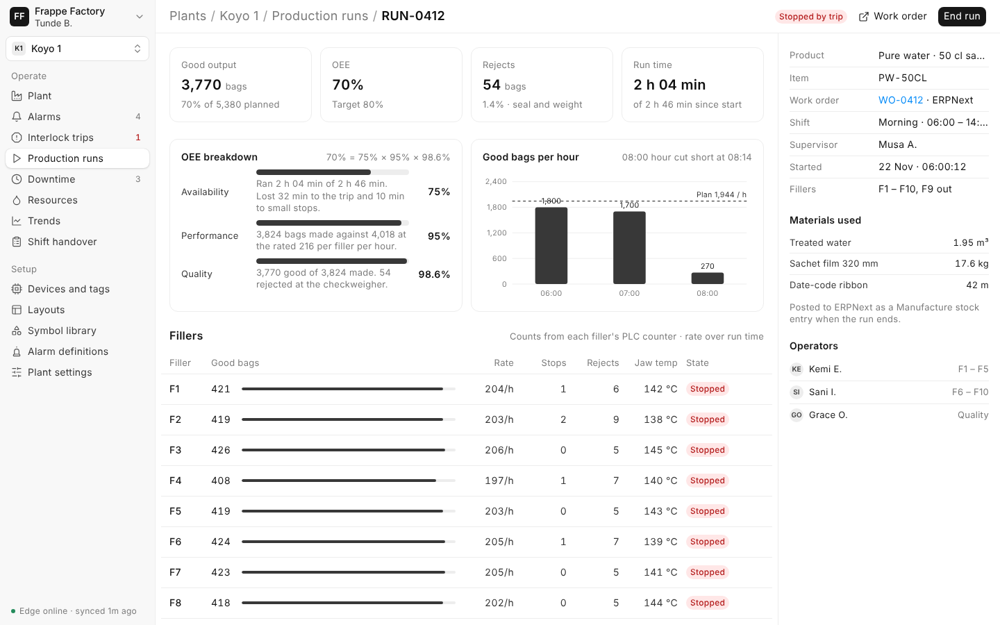

## 12 · Downtime

## 13 · Resources

## 14 · Trends

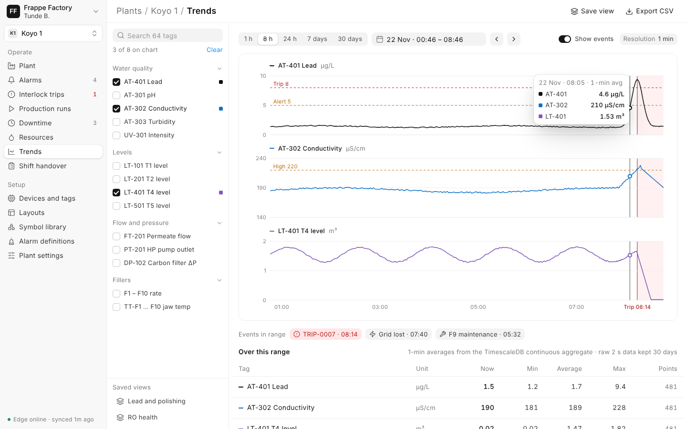

## 15 · Shift handover

## 16 · Kiosk · open session

## 17 · Kiosk · sign in (assigned users only)

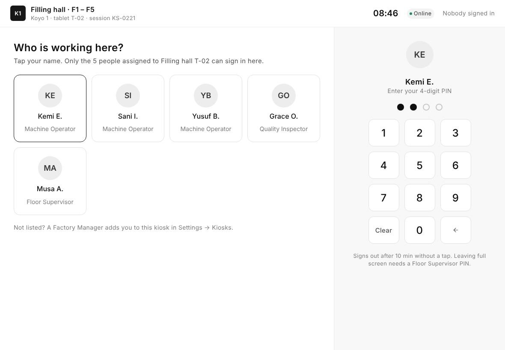

## 18 · Kiosk · line view

## 19 · Plant · Rice mill

## 20 · Plant · Oil mill

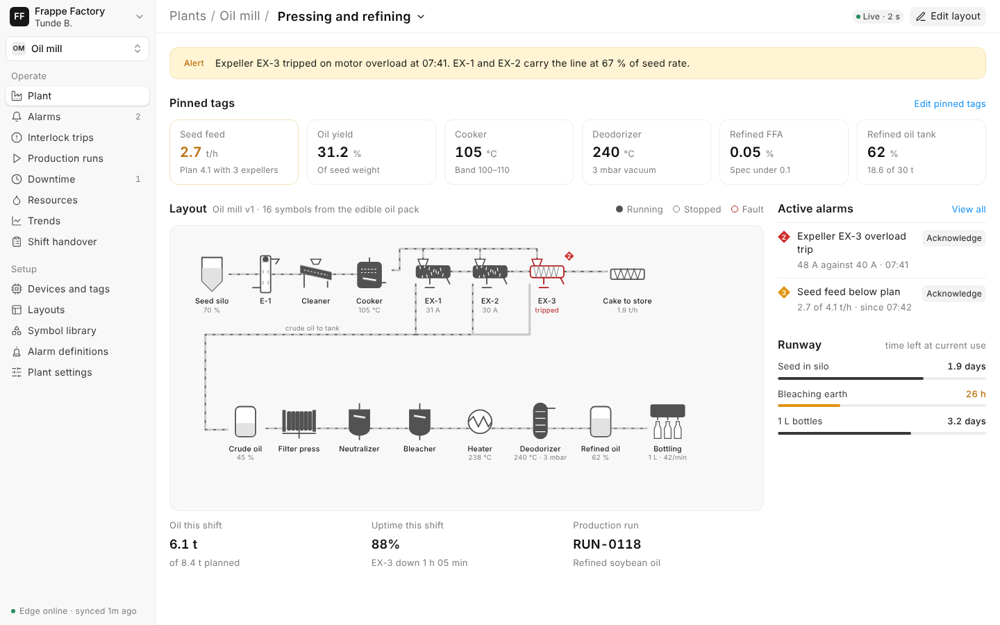

## 21 · Devices and tags

## 22 · Layout editor

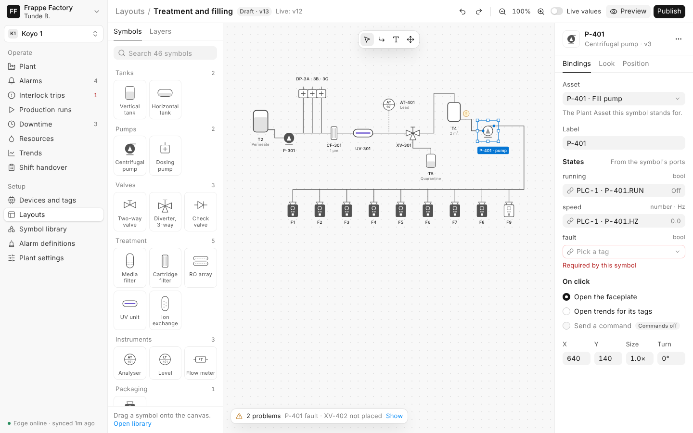

## 23 · Symbol library · industry packs

## 24 · Alarm definitions

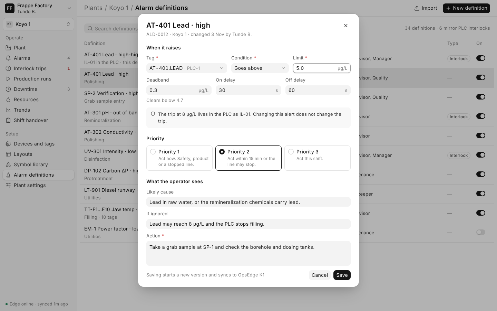

## 25 · Plant settings · connector

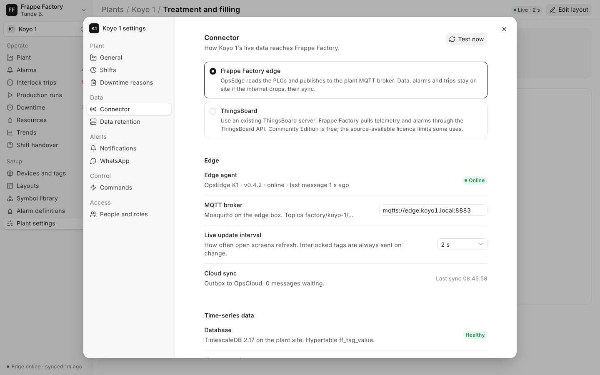

## 26 · Plant settings · commands

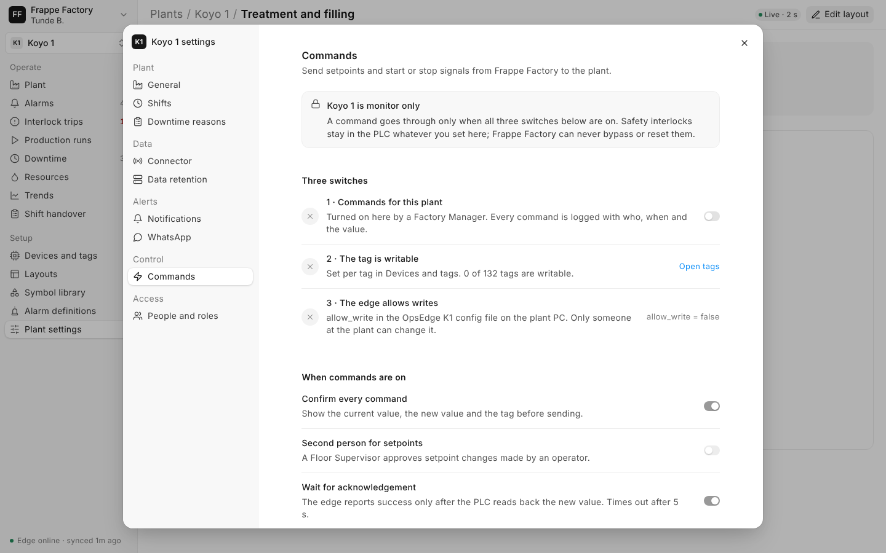
